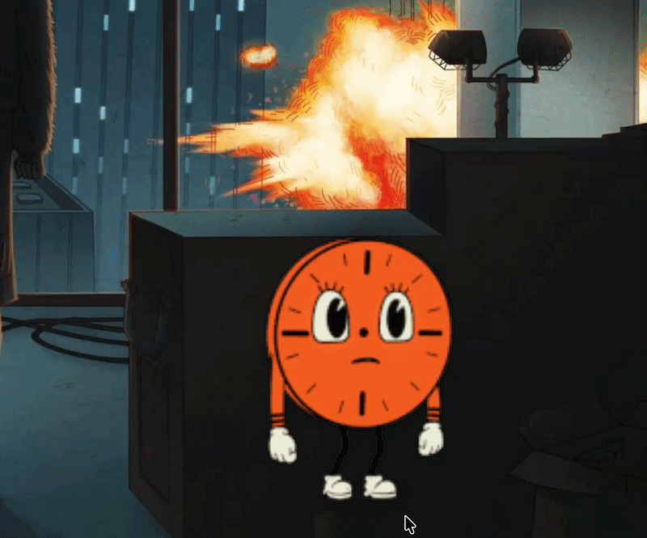

# Sippy

A free, open-source macOS menu-bar buddy that reminds you to drink water. Every 25 minutes she walks in from the edge of your screen, offers you a glass, and leaves the moment you confirm or snoozes for 5.




## Why

Just a fun little project to remind me to drink water. Every 25 minutes a tiny human walks onto my screen holding a glass, and I can't ignore her the way I ignore notifications. That's it, drink water, stay hydrated. 

## Install

### Pre-built DMG

Open **`Sippy.dmg`** → drag **Sippy** into **Applications**, eject, then (one-time per machine):

```sh
xattr -cr /Applications/Sippy.app
open /Applications/Sippy.app
```

The `xattr` step is needed because the DMG is ad-hoc signed (no Apple Developer ID / notarization), so Gatekeeper quarantines it on first download. After that it lives in your menu bar — click `💧` → **Preview reminder now** to meet her immediately. Each fresh DMG you download needs the one-timer again.

### Build from source

Requires macOS 13+ and a Swift toolchain (Command Line Tools are enough).

```sh
# Run for development:
swift run
```


```sh
# Package for sharing:
swift build -c release && \
BIN=.build/out/Products/Release && APP=dist/Sippy.app && \
rm -rf dist Sippy.dmg && mkdir -p "$APP/Contents/MacOS" "$APP/Contents/Resources" && \
cp "$BIN/Sippy" "$APP/Contents/MacOS/" && \
cp -R "$BIN/Sippy_Sippy.bundle" "$APP/Contents/Resources/" && \
cp packaging/Info.plist "$APP/Contents/" && \
cp packaging/AppIcon.icns "$APP/Contents/Resources/" && \
codesign --force --deep --sign - dist/Sippy.app && \
./.dmgtools/bin/dmgbuild -s packaging/dmg_settings.py Sippy Sippy.dmg && \
rm -rf dist && ls -la Sippy.dmg
```


## Buddies

Click `💧` → **Settings…** in the menu bar to pick who reminds you and how often (15–60 min):

- **Maya** — the original tiny human with a glass of water.
- **Miss Minutes** — waves while she slides in, greets you for a few seconds after landing, then looks at her clock waiting while you decide, and walks off-screen when you confirm.

Adding your own is just a folder: drop `Sources/Sippy/Resources/Characters/<id>/` with a `character.json`(name + which frame folders are walk/hi/wait) and PNG frames in `walk/`, `hi/`, `wait/` subfolders, then rebuild. She shows up in Settings automatically.

## Permissions

Sippy asks for nothing. No camera, mic, accessibility, or location — just a menu-bar item and a floating panel. The only system integration is the optional login item, which macOS gates behind your explicit toggle.


